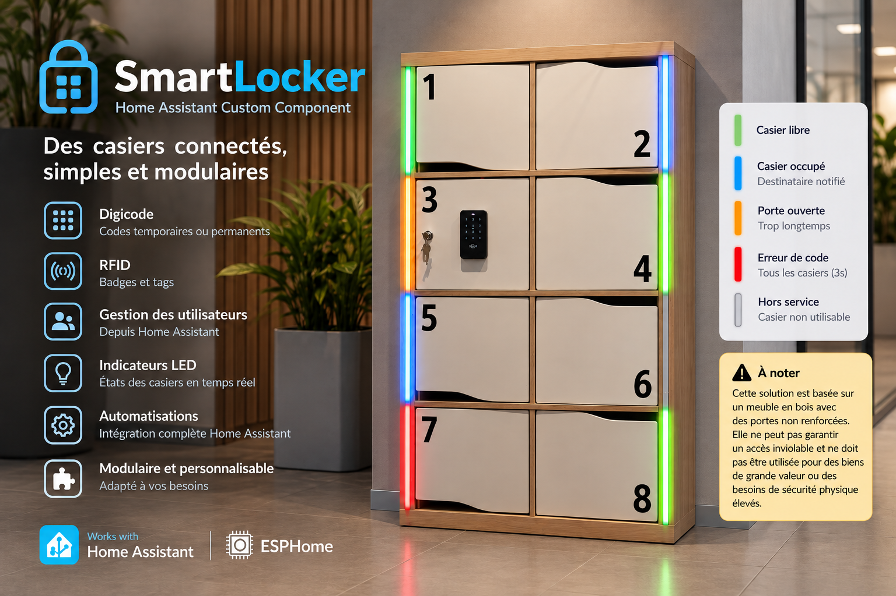

# Smart Locker - Casiers connectés pilotés par Home Assistant

Une personne dépose un colis dans un casier libre, l'affecte à un destinataire via une interface mobile, et ce destinataire reçoit une notification puis récupère son colis en tapant son code personnel devant le meuble, ou en présentant son badge s'il en a un. Pas de clé, pas de badge obligatoire, pas d'attente.



---

## Le principe

Le support est une étagère **IKEA Kallax 4x2** (8 cases). La case 3 sert de **compartiment technique** (carte relais, alimentation, bornier) ; les **7 autres cases** sont des casiers, chacun équipé d'une porte, d'une serrure solénoïde, d'un capteur d'ouverture (reed switch) et d'une portion de ruban LED pour communiquer l'état au gestionnaire comme au destinataire.

Le cerveau du système est un **mini PC** sous Home Assistant OS, placé dans une baie séparée avec sa propre alimentation. Deux cartes ESP32 sous ESPHome et un contrôleur LED WLED (Gledopto) lui sont connectés en WiFi : une carte 8 relais qui pilote les serrures et lit l'état des portes, et un digicode Wiegand 26 positionné devant le meuble. Toute la logique métier (états des casiers, PIN, destinataires, notifications) est portée par un **custom component Home Assistant** `smart_locker`, avec ses cartes Lovelace.

Le système est conçu pour un usage intérieur en environnement de confiance. Pas de sécurité de niveau industriel : l'objectif est la praticité et la traçabilité légère.

---

## Ce que voit l'utilisateur

L'éclairage s'allume dès qu'on touche le digicode (ou qu'on ouvre une porte) et s'éteint après 30 s sans activité. Chaque casier indique alors son état :

| Couleur | État |
|---|---|
| 🟢 Vert fixe | Casier libre (ou colis déjà récupéré) |
| 🔵 Bleu fixe | Colis en attente |
| 🟢 Vert clignotant (autres éteints) | Code ou badge correct, ce(s) casier(s) s'ouvre(nt) |
| 🟠 Orange clignotant | Porte ouverte depuis trop longtemps (visible même éclairage éteint) |
| 🔴 Rouge clignotant (tous, 3s) | Code incorrect, saisie abandonnée (10 s sans touche) ou badge inconnu : on peut recommencer |
| 🔴 Rouge fixe | Casier hors service |

---

## Parcours d'un colis

1. Le gestionnaire dépose le colis et assigne le casier à un destinataire depuis le dashboard HA → un **PIN à 6 chiffres** est généré.
2. Il clique sur **Notifier** → le destinataire reçoit son PIN par email, SMS et/ou app mobile.
3. Le destinataire tape ses 6 chiffres sur le digicode, ou présente son badge (qui ouvre tous ses casiers en attente) → la serrure s'ouvre.
4. Quand la porte est refermée, le casier se libère automatiquement.

Détails : [dashboard admin](docs/home-assistant/dashboard.md).

---

## Contenu du dépôt

| Répertoire | Contenu |
|---|---|
| [`custom_components/smart_locker/`](custom_components/smart_locker/) | Custom component HA + cartes Lovelace (`www/`), installable par HACS |
| [`esphome/`](esphome/) | Configurations ESPHome (carte relais, digicode) + modèle de `secrets.yaml` |
| [`docs/`](docs/index.md) | Documentation matérielle et logicielle |
| [`wled/`](wled/) | Sauvegarde de la configuration et des presets du contrôleur WLED |

---

## Documentation technique

Tout ce qu'il faut pour construire et configurer le système :

- **[Mise en service](docs/mise-en-service.md)** - toutes les étapes dans l'ordre, du câblage à la recette
- [Serrure solénoïde](docs/hardware/serrure.md) - pilotage relais et retour via reed switch
- [Alimentation](docs/hardware/alimentation.md) - architecture 230V / 12V 20A
- [Éclairage WLED Gledopto](docs/hardware/wled-gledopto.md) - rubans COB, segments par casier, code couleur
- [ESPHome - Carte relais](docs/esphome/carte-relais.md) - brochage et config LC-Relay-ESP32-8R-D5
- [ESPHome - Digicode Wiegand 26](docs/esphome/digicode-wiegand.md) - saisie code PIN, badge RFID
- [Home Assistant - Intégrations](docs/home-assistant/integrations.md) - entités, services, notifications
- [Home Assistant - Dashboard admin](docs/home-assistant/dashboard.md) - installation du composant, cartes Lovelace
- [Budget](docs/budget.md)
- [Fiche technique à imprimer](docs/fiche/fiche-technique.pdf) - câblage et dépannage, recto-verso A4

---

## Tests

Tests du custom component dans un Home Assistant de test (WLED simulé) :

```bash
pip install -r requirements_test.txt
pytest
```

---

## Publier une nouvelle version (HACS)

HACS propose une mise à jour quand une **release GitHub** plus récente existe.

1. Mettre à jour `version` dans [`custom_components/smart_locker/manifest.json`](custom_components/smart_locker/manifest.json)
   (par exemple `0.10.0` → `0.10.1`), puis fusionner dans `main`.
2. Créer et pousser le tag correspondant :
   ```bash
   git checkout main && git pull && git tag v0.10.1 && git push origin v0.10.1
   ```
3. Sur GitHub : **Releases › Draft a new release**, choisir le tag `v0.10.1`, décrire les changements,
   **Publish release**.

Le numéro du tag doit correspondre à celui du manifest : c'est aussi lui qui force les navigateurs à
recharger les cartes Lovelace.

---

## Licence

© 2026 Mikael Mourcia. Ce projet (code, configurations et documentation) est publié sous licence
[Creative Commons Attribution - Pas d'Utilisation Commerciale - Partage dans les Mêmes Conditions 4.0
International (CC BY-NC-SA 4.0)](https://creativecommons.org/licenses/by-nc-sa/4.0/deed.fr) :
réutilisation et modification libres en citant l'auteur, sans usage commercial, et les dérivés
sont partagés sous la même licence. Texte complet : [LICENSE](LICENSE).
