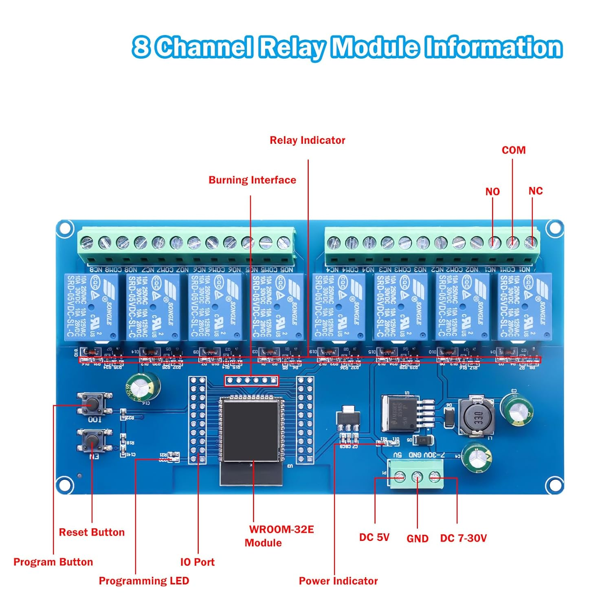
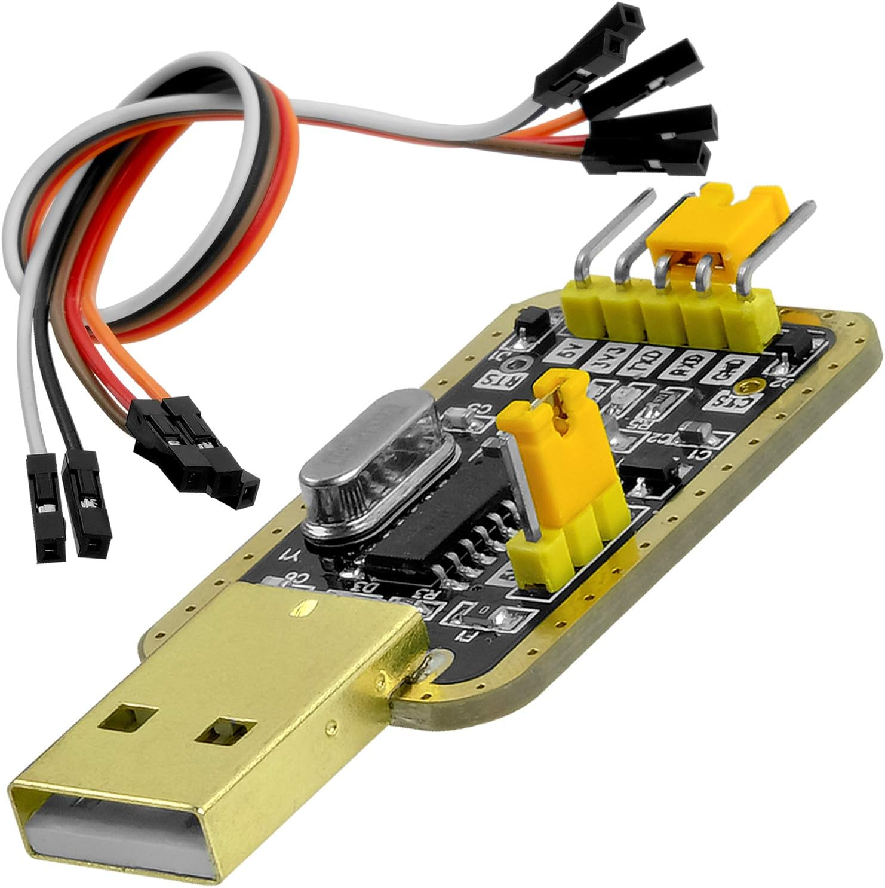

# ESPHome - Carte relais LC-Relay-ESP32-8R-D5



La **LC-Relay-ESP32-8R-D5** est une carte tout-en-un combinant :
- Un module **ESP32** (WiFi + Bluetooth)
- **8 relais** 10A/250VAC (utilisés ici en 12V DC)
- Alimentation directe en **12V** (régulateur embarqué 3.3V/5V pour l'ESP32)
- Connecteurs screw terminal pour chaque relais (COM/NO/NC)

## Brochage utilisé

La case 3 du Kallax est le **compartiment technique** (carte relais, alimentation, bornier) :
pas de serrure ni de reed switch. Le relais 3 (GPIO25) est laissé libre et n'est pas déclaré
dans ESPHome. Les numéros de casiers sont conservés (1, 2, 4…8) pour coller à la position
physique dans le meuble.

| Casier | Relais (serrure) | Reed switch (porte) |
|---|---|---|
| 1 | GPIO32 | GPIO4 |
| 2 | GPIO33 | GPIO16 |
| 3 | *(GPIO25, non utilisé)* | - |
| 4 | GPIO26 | GPIO17 |
| 5 | GPIO27 | GPIO18 |
| 6 | GPIO14 | GPIO19 |
| 7 | GPIO12 | GPIO21 |
| 8 | GPIO13 | GPIO22 |

Les GPIO des reed switches ont été choisis pour n'avoir **aucune contrainte** : pas de strapping
pin, pas d'entrée seule (34-39 évités). Ils utilisent le **pull-up interne** de l'ESP32
(`mode: INPUT_PULLUP`), aucune résistance externe n'est nécessaire.

Câblage d'un reed : une borne sur le GPIO, l'autre sur GND. Porte fermée = contact fermé =
niveau bas = `off` (*Fermée*) dans Home Assistant. Si l'état apparaît inversé, ajouter
`inverted: true` sous `pin:`.

## Configuration ESPHome

Fichier de référence : [`esphome/smartlocker-relais.yaml`](../../esphome/smartlocker-relais.yaml).
Les secrets (clé API, mots de passe OTA et AP de secours) sont dans `secrets.yaml`, voir
[`esphome/secrets.yaml.example`](../../esphome/secrets.yaml.example).

Structure du fichier :

| Bloc | Contenu |
|---|---|
| `switch` (gpio) | 7 relais `relay_1`…`relay_8` (sans 3), `restore_mode: ALWAYS_OFF` |
| `button` (template) | 7 boutons « Ouvrir casier N » : relais ON → 400 ms → OFF |
| `binary_sensor` (gpio) | 7 capteurs « Porte casier N », `device_class: door`, anti-rebond 50 ms |
| `wifi.use_address` | IP fixe de la carte (192.168.0.15) pour l'OTA |

Exemple d'un casier (les autres sont identiques) :

```yaml
switch:
  - platform: gpio
    name: "Relais casier 1"
    id: relay_1
    pin: GPIO32
    restore_mode: ALWAYS_OFF

button:
  - platform: template
    name: "Ouvrir casier 1"
    on_press:
      - switch.turn_on: relay_1
      - delay: 400ms
      - switch.turn_off: relay_1

binary_sensor:
  - platform: gpio
    name: "Porte casier 1"
    id: door_1
    pin:
      number: GPIO4
      mode: INPUT_PULLUP
    device_class: door
    filters:
      - delayed_on: 50ms
      - delayed_off: 50ms
```

## Points d'attention

- **restore_mode: ALWAYS_OFF** : garantit que les relais sont ouverts au redémarrage.
- **Ne jamais piloter le `switch` directement** depuis HA : passer par le `button`, qui borne
  l'impulsion à 400 ms (le solénoïde grille s'il reste alimenté, voir [serrure](../hardware/serrure.md)).
  Le composant `smart_locker` n'utilise que les boutons.
- L'ESP32 de cette carte peut avoir les niveaux de GPIO relais inversés (actif LOW) selon la
  version du PCB. Si les relais fonctionnent à l'envers, ajouter `inverted: true` sur les pins concernées.
- GPIO12 (relais 7) est une strapping pin (tension flash) imposée par le PCB. Elle est à l'état
  bas au boot tant que le relais est au repos : ne rien y ajouter.

## Flashage initial



La carte ne dispose pas d'un port USB natif. Le premier flash passe par un adaptateur **USB-UART TTL** externe.

Pinout de la carte : [forum HACF](https://forum.hacf.fr/t/carte-8-relais-avec-esp32-branchement-usb-uart/48181)

### Câblage USB-UART vers carte

| USB-UART | Carte LC-Relay |
|---|---|
| TX | RX de la carte |
| RX | TX de la carte |
| GND | GND |
| 5V | VCC de la carte |

Le 5V fourni par l'adaptateur USB-UART suffit à alimenter l'ESP32 pendant le flash.

### Passage en mode flash

Mettre un cavalier entre **GND et GPIO0** avant de brancher l'USB-UART, pour forcer l'ESP32 en mode bootloader. Retirer le cavalier après le flash.

### Commande

Avec la CLI ESPHome, compilation et flash série en une fois :

```bash
esphome run esphome/smartlocker-relais.yaml --device /dev/ttyUSB0
```

Alternative : télécharger le binaire depuis le dashboard ESPHome de HA (*Install › Manual
download › Factory format*) puis le flasher avec esptool :

```bash
esptool --chip esp32 --port /dev/ttyUSB0 --baud 460800 write_flash -z 0x0 smartlocker-relais.factory.bin
```

Identifier le bon port avec `ls /dev/tty*` avant et après branchement de l'adaptateur.

Les mises à jour suivantes se font en OTA depuis l'interface ESPHome de Home Assistant.
