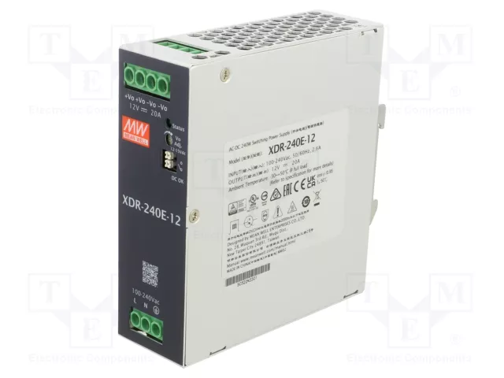

# Alimentation

Alimentation choisie : **Mean Well XDR-240-12** - 12V / 20A / 240W, format rail DIN.

## Architecture

| Source | Consommateur |
|---|---|
| Mean Well XDR-240-12 (12V / 20A) | Carte relais ESP32, serrures x7, contrôleur et rubans LED, clavier du digicode |
| Convertisseur 12V → 5V 15A (alimenté par la Mean Well) | ESP32 du digicode |

## Pourquoi 20A ?

| Consommateur | Courant estimé |
|---|---|
| Solénoïdes x7 (inrush simultané max) | 7 x 1 A = 7 A |
| Carte LC-Relay-ESP32-8R-D5 | ~0,5 A |
| ESP32 du digicode (via convertisseur 5V) + clavier | ~0,3 A |
| Rubans COB adressables x2, 53 pixels (limité à 3 A par WLED) | ≤ 3 A |
| **Total crête théorique** | **~11 A** |

En pratique les solénoïdes fonctionnent en impulsionnel (400 ms) et ne sont jamais tous actifs simultanément. Les LED ne sont jamais toutes à pleine luminosité. Le XDR-240-12 à 20A offre une marge confortable.

## Distribution 12V

Le transformateur dispose directement de plusieurs paires de bornes V+/V- en sortie. Chaque consommateur (serrures, contrôleur LED, carte relais, clavier du digicode, convertisseur 5V) est raccordé directement sur ces bornes avec du câble 2x0,5 mm².

L'ESP32 du digicode n'accepte pas le 12V : il est alimenté en 5V par un convertisseur abaisseur 12V → 5V (15A, très largement surdimensionné pour un ESP32 mais peu coûteux), branché sur les bornes 12V de la Mean Well.

## Ouverture de secours

Il n'y a pas de bouton d'urgence câblé. En cas de panne, les serrures s'ouvrent à la main, **une à
une, par une impulsion de 1 à 2 s** (jamais plus de 5 s : le solénoïde grille).

Au repos, le contact COM–NO du relais est ouvert : du 12V appliqué sur le **COM** n'atteint pas la
serrure. Il faut toujours alimenter le côté **NO** (ou le + du solénoïde).

| Panne | Procédure |
|---|---|
| Home Assistant ou ESP32 en panne, alimentation 12V OK | Un fil volant entre le **COM** et le **NO** du relais du casier, pendant 1 s : il remplace le relais |
| Alimentation 12V en panne | Batterie 12V : **+ sur le NO** du relais du casier (ou le + du solénoïde), **− sur le GND** du bornier, pendant 1 à 2 s |

- Mettre un **fusible (5 A)** sur le fil + de la batterie, au plus près d'elle : une batterie au
  plomb peut débiter des centaines d'ampères en court-circuit.
- Si la Mean Well est toujours branchée, relier le − de la batterie au même GND qu'elle.
- Selon le modèle, la serrure peut aussi avoir une libération mécanique de secours (câble ou
  tirette) : à vérifier sur la serrure installée.
