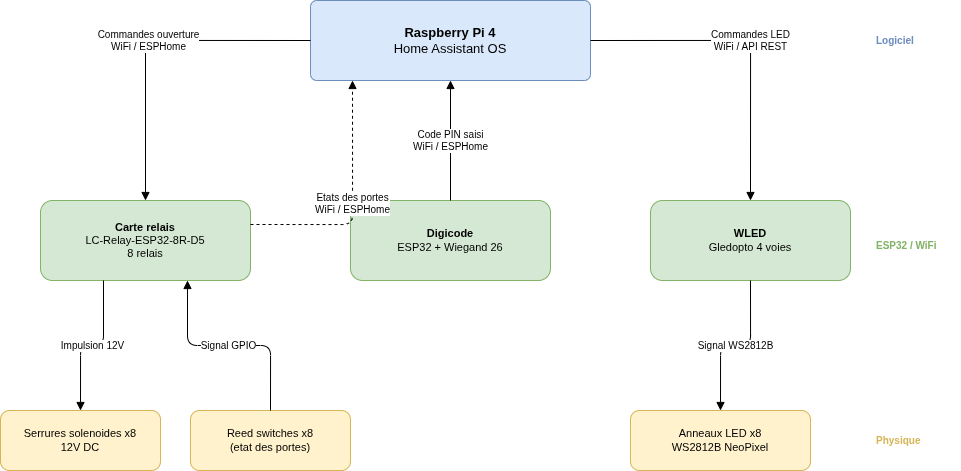

# Documentation Smart Locker

## Architecture

Le schéma source est disponible dans [architecture.drawio](architecture.drawio) (ouvrable sur [diagrams.net](https://app.diagrams.net)).

---

## Table des matières

### Matériel
- [Serrure solénoïde](hardware/serrure.md) - Pilotage via relais, retour d'état via reed switch
- [Alimentation](hardware/alimentation.md) - Architecture 230V → 12V/20A
- [Éclairage WLED Gledopto](hardware/wled-gledopto.md) - Rubans COB, un segment par casier, code couleur
- [Fraisage logements LED](hardware/fraisage.md) - *Abandonné* (anneaux LED remplacés par les rubans)

### ESPHome
- [Carte relais LC-Relay-ESP32-8R-D5](esphome/carte-relais.md) - 7 serrures, 7 reed switches (case 3 = compartiment technique)
- [Digicode Wiegand 26](esphome/digicode-wiegand.md) - PIN 6 chiffres, badge RFID, protocole Wiegand 26

Les fichiers YAML sont dans [`esphome/`](../esphome/).

### Home Assistant
- [Intégrations](home-assistant/integrations.md) - ESPHome, WLED, notifications, composant `smart_locker`
- [Dashboard admin](home-assistant/dashboard.md) - Installation du composant, cartes Lovelace, utilisation

### Backend
- [Backend](backend/README.md) - Où vit la logique métier (custom component) et pistes d'évolution

### Projet
- [Budget](budget.md) - Liste des composants et coûts

---

> Ce projet tourne sur un mini PC sous Home Assistant OS.
> Support physique : IKEA Kallax 4×2 — 7 casiers + 1 compartiment technique (case 3).
> Voir le [README principal](../README.md) pour la vue d'ensemble.
